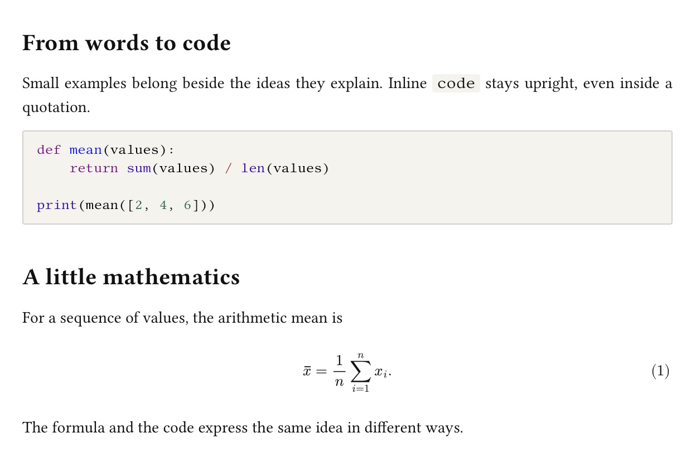
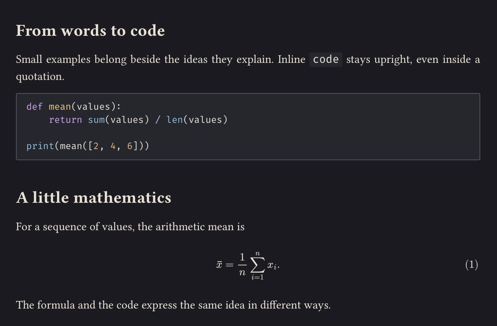
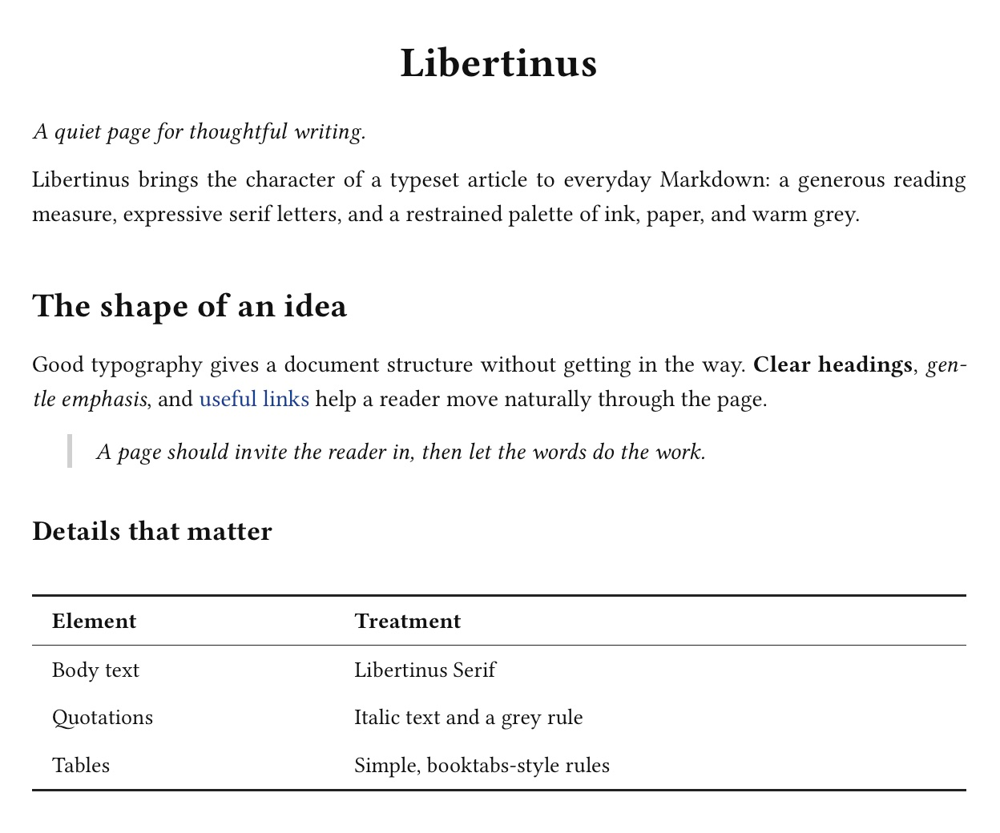
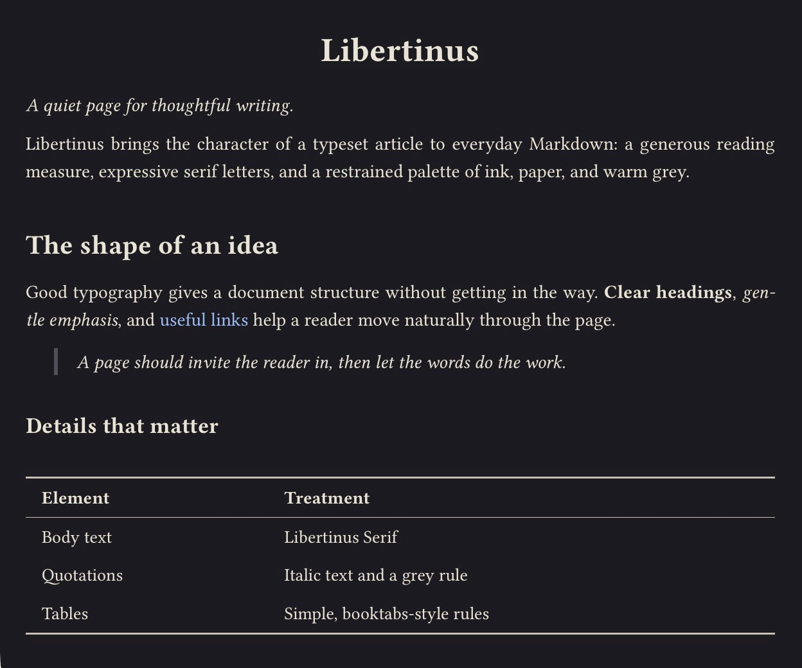

# Libertinus

**A Typora theme for the technical thinker.**

For the proof you’re working through, the code that makes it concrete, and the paragraph that ties it together. Libertinus gives everyday Markdown the feel of a typeset article, with the measured lines and serif typography of a LaTeX page.

[Download the theme](https://github.com/wei-yuhang/typora-theme-libertinus/releases/latest) · [Read the sample](sample.md) · [Install](#install)

| Libertinus | Libertinus Dark |
| :---: | :---: |
|  |  |

## The page

Libertinus Serif and a 16 cm text measure give long paragraphs room to breathe. Headings follow the proportions of a LaTeX article, tables use booktabs-style rules, and quotations sit in italics beside a thin grey line. Code keeps its own voice in Fira Code, upright even inside a quotation. Click a fenced block to change its language in the footer below it.

Choose a light page or warm charcoal with ivory text. Both keep the same typography and layout, so the document feels familiar when you switch.

See headings, quotations, and tables

| Libertinus | Libertinus Dark |
| :---: | :---: |
|  |  |

## Install

1. Download and unzip the [latest release](https://github.com/wei-yuhang/typora-theme-libertinus/releases/latest), or download [`libertinus.css`](libertinus.css) and [`libertinus-dark.css`](libertinus-dark.css) individually.
2. In Typora, open **Settings → Appearance → Open Theme Folder**. Copy both CSS files into the folder and keep them together: Libertinus Dark shares its layout with the light theme.
3. Restart Typora and select **Themes → Libertinus** or **Libertinus Dark**. Open [`sample.md`](sample.md) to see how it looks.

## Fonts

The theme works with system fallbacks. For the look in the screenshots, install these fonts separately, then restart Typora:

| For | Font |
| --- | --- |
| Prose and headings | [Libertinus Serif](https://github.com/alerque/libertinus/releases). The same release includes Libertinus Sans for interface text. |
| Code | [Fira Code](https://github.com/tonsky/FiraCode). JetBrains Mono and Libertinus Mono are among the fallbacks. |
| Simplified Chinese | [思源宋体 (Source Han Serif SC)](https://github.com/adobe-fonts/source-han-serif/releases), with Noto Serif CJK and system serif fallbacks. |

The CSS also lists Libertinus Math. Typora’s math renderer controls the glyphs it draws as SVG.

## PDF and platform notes

For white PDF pages while writing in dark mode, select **Libertinus** under **Settings → Export → PDF → Theme**. Typora controls paper size and margins. See [Typora’s PDF export guide](https://support.typora.io/Export/#theme-2).

The original light theme has been used long-term on Windows by the author. Both variants were checked in Typora 1.14.15 on macOS. The dark variant still needs Windows testing, and Linux is untested.

## License

The theme, sample, and screenshots are available under the [MIT License](LICENSE). The fonts retain their own licenses.
